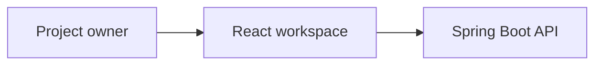
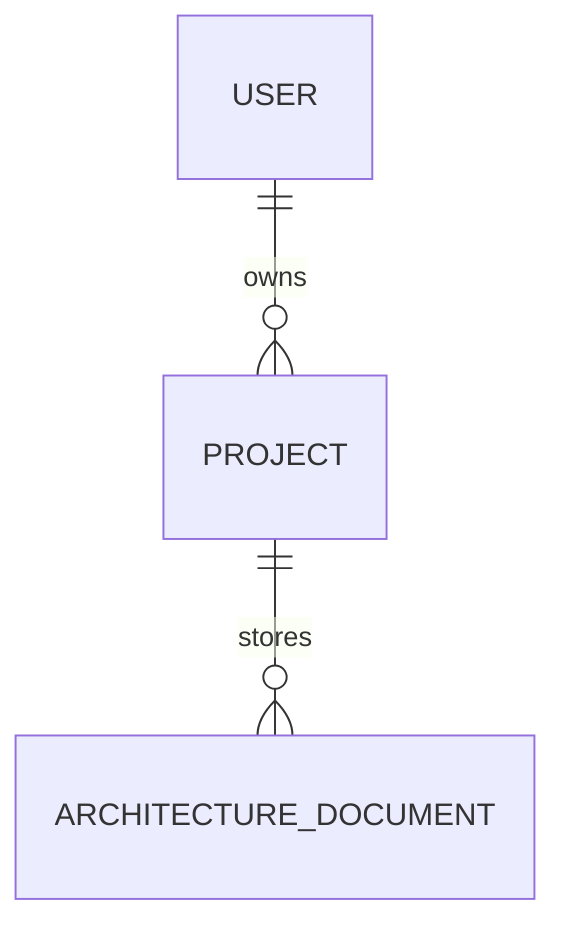
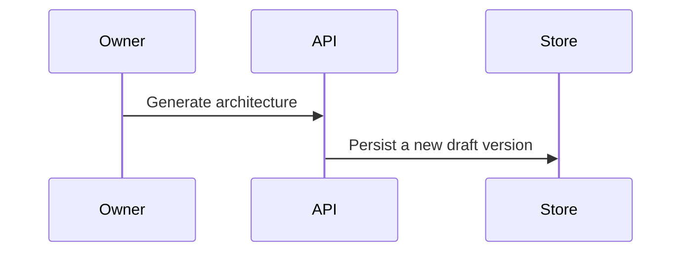

# Architecture Generation

## Workflow

1. Sign in and open an owned project.
2. Open **Architecture**. The workspace loads saved requirements and architecture documents.
3. Approved requirements are selected by default. The owner can select a subset; pending and rejected requirements cannot be used.
4. Choose **Generate Architecture**. The backend rechecks project ownership and the current approval status, then sends the project description and selected requirement details to the configured provider.
5. A validated response is saved as a new `DRAFT` version. The UI identifies the provider and clearly marks mock output as demo content.
6. Edit the draft, inspect its four Mermaid previews or source, then approve or reject it.
7. Reopen any saved version from the project's architecture history.

Edits and review actions are permitted only while a document is `DRAFT`. Regeneration creates a new version and does not replace an earlier approved or rejected document. Requirements referenced by any architecture document cannot be deleted, preserving source traceability.

## Document structure

The generated Markdown content is grounded in the saved project description and selected approved requirements. It includes:

- Project overview and architecture goals.
- Functional/non-functional requirement mapping.
- Recommended style and high-level architecture.
- Frontend, backend, database, and API design.
- Major components, interactions, and data flow.
- Authentication/authorization and security considerations.
- Scalability, performance, technology recommendations, and justifications.
- External integrations/dependencies, risks, assumptions, and trade-offs.

The API also returns the exact source requirement UUIDs, architecture style, provider, review status, version, and timestamps.

## Mermaid diagrams

Every new generated document contains four named Mermaid sources: `systemContext`, `components`, `entityRelationship`, and `workflow`. The backend accepts a deliberately limited syntax subset and rejects malformed/unsupported content before saving. The frontend additionally runs Mermaid's parser in strict security mode before rendering. If parsing fails, the preview is withheld, an error is shown, and the underlying source remains available.

Supported examples:







The flowchart subset supports labeled nodes and directed edges. The ER subset supports relationships (not full Mermaid entity-field declarations); sequence diagrams support participants and messages. Mermaid directives, HTML, and unsupported diagram constructs are rejected. The browser parser remains the final syntax/renderability check.

## API

All routes require an authenticated session. Mutating requests use the existing CSRF cookie/token and `X-XSRF-TOKEN` header. Project and document reads/writes are scoped to the authenticated owner; another user's project/document is returned as `404`.

| Method | Route | Behavior |
|---|---|---|
| `POST` | `/api/projects/{projectId}/architecture/generate` | Generate and persist a new draft version from `sourceRequirementIds`; returns `201` |
| `GET` | `/api/projects/{projectId}/architecture` | List the project's architecture documents, newest version first |
| `GET` | `/api/projects/{projectId}/architecture/{documentId}` | Retrieve a document |
| `GET` | `/api/projects/{projectId}/architecture/{documentId}/versions` | List project versions for history |
| `PUT` | `/api/projects/{projectId}/architecture/{documentId}` | Edit a draft's title, style, content, and diagrams |
| `POST` | `/api/projects/{projectId}/architecture/{documentId}/approve` | Approve a draft |
| `POST` | `/api/projects/{projectId}/architecture/{documentId}/reject` | Reject a draft |

Generation request:

```json
{
  "sourceRequirementIds": ["approved-requirement-uuid"]
}
```

Validation errors (including unapproved, foreign-project, or invalid Mermaid input) return `400`; missing/non-owned resources return `404`; editing or reviewing a non-draft returns `409`; provider or generated-response failures are surfaced as errors and are not saved as successful output.

## Persistence

`architecture_documents` stores the content, style, provider, JSON-serialized diagram map, review status, version, and audit timestamps. Existing legacy columns (`summary`, `components`, `database_design`, and `api_endpoints`) remain populated for compatibility. `architecture_document_requirements` records source requirement UUIDs.

Versions are unique within a project. Generation allocates the next version under an owned-project lock; the repository orders versioned documents before legacy rows with a null version. Hibernate's existing `ddl-auto=update` is additive, not a versioned database migration. Review and editing do not create new versions; only regeneration does.

## AI provider configuration

Architecture generation uses the same provider selection and shared Spring AI client as requirements generation:

- `APP_AI_PROVIDER=mock` (default): deterministic sample architecture labeled `MOCK_DEMO` / demo output.
- `APP_AI_PROVIDER=openai`: enables the optional OpenAI provider.
- `OPENAI_API_KEY`: required only for the OpenAI provider; supply through backend environment or a secret manager.
- `OPENAI_MODEL`: optional; defaults to `gpt-4o-mini`.

There is no silent fallback to mock output after an OpenAI error. Provider output is parsed and validated before persistence. Automated tests use mock providers and do not call a paid model.

## Local development and tests

Start PostgreSQL and provide `DB_USERNAME` and `DB_PASSWORD` to the backend process. The default application datasource is `ai_sdlc`; do not use that database for test validation. For any live persistence check, explicitly set `SPRING_DATASOURCE_URL=jdbc:postgresql://localhost:5432/ai_sdlc_test` and verify the active datasource before making requests. Never run cleanup or destructive tests against the original database.

From `backend/`, run `mvn test`. The automated suite uses in-memory H2 with `create-drop`, including architecture API, ownership, approval, validation, versioning, and source-reference tests. It does not establish PostgreSQL persistence or restart behavior for architecture documents.

From `frontend/`, run:

```powershell
npm run build
npm run lint
npm run typecheck:e2e
```

With the Vite development server running, run:

```powershell
npm run test:e2e -- tests/architecture.spec.ts tests/requirements.spec.ts --workers=1
```

These Playwright tests use API fixtures; they verify browser behavior, not live backend persistence. The existing PostgreSQL restart report covers authentication and project records only. The architecture workflow has not yet been verified against live PostgreSQL or across a backend restart. OpenAI generation has not been run. The production build currently warns about large dynamically loaded Mermaid/layout chunks.
